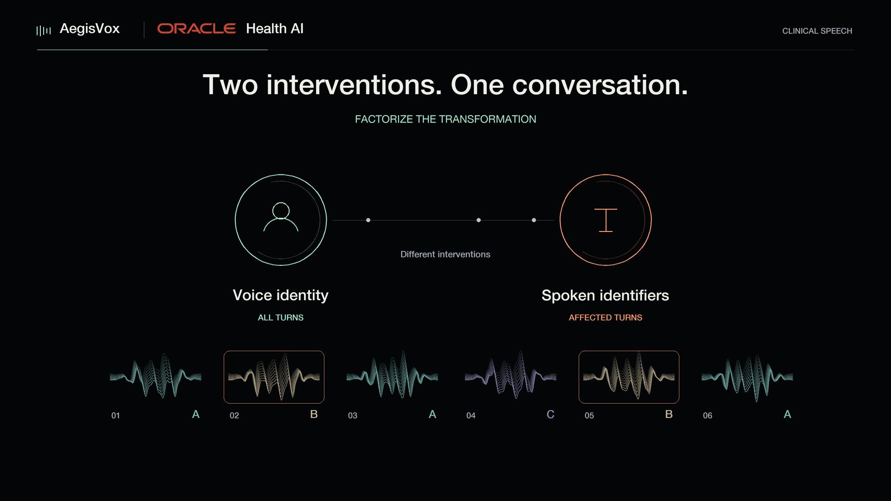

<div align="center">

# AegisVox
### Factorized privacy. Conversation-level context. Stage-resolved evaluation.

**Oracle Health AI** · Research framework

[Quick start](#start-in-two-minutes) · [Documentation](https://spraphul.github.io/aegisvox/) · [Architecture](docs/guides/architecture.md) · [Watch the silent film](docs/assets/aegisvox-demo.mp4) · [Evaluation](docs/guides/evaluation.md)

[](pyproject.toml)
[](LICENSE)
[](https://github.com/spraphul/aegisvox/actions/workflows/tests.yml)

[](docs/assets/aegisvox-demo.mp4)

*Speech carries more than words: delivery, pauses, accents, speaker roles, and the rhythm of an interaction.*

</div>

## Change the identifiers, not the whole conversation

AegisVox separates **voice identity transformation** from **spoken identifier replacement**.
It assigns a consistent surrogate voice to each speaker, converts every speaker turn,
and renders complete turns only where a lexical change is planned. The other converted
turns and their surrounding context flow into reconstruction without lexical rerendering.

The framework is renderer-independent. **F5-TTS** synthesizes the replacement turn from
its revised transcript and voice reference. **VoiceCraft** edits speech using audio and
text conditioning. Neither renderer is the framework itself.

| Identity path | Lexical path | Evidence path |
| :--- | :--- | :--- |
| Retrieve a distinct voice reference for each speaker; use SeedVC on all turns. | Detect identifiers, plan consistent same-language substitutions, render affected complete turns. | Keep original, converted, edited, and reconstructed artifacts separate. Measure each endpoint at its actual stage. |

**Research software, not a de-identification guarantee.** Conversion can leave speaker
linkage, planned edits can fail, and a detector can miss identifiers. Do not release
clinical recordings based on this software's output alone.

## Start in two minutes

```bash
git clone https://github.com/spraphul/aegisvox.git
cd aegisvox
python3 -m venv .venv
source .venv/bin/activate
pip install -e '.[dev,evaluation]'
aegisvox demo --output runs/first-demo
pytest -q
```

The demo uses **synthetic tones**, not speech or patient data. It tests complete-turn
routing, gap preservation, exact sample insertion, and output lineage without a GPU,
API key, or model download. It does not measure privacy or speech quality.

```text
runs/first-demo/
├── converted_fixture.wav
├── turns.json
└── result/
    ├── final.wav
    ├── reconstruction.json       # hashes, sample intervals, insertion checks
    └── turns/0001/
        ├── reference.wav         # the entire selected converted turn
        └── edited.wav
```

### Bring your real models

1. Provision licensed model checkpoints in separate environments.
2. Run diarization, retrieval, SeedVC, transcription, and replacement planning.
3. Provide the converted conversation and complete-turn transcript pairs.
4. Render and reconstruct with a real adapter; evaluate the output separately.

```bash
# In an environment provisioned with F5-TTS and its dependencies:
aegisvox render-turns examples/complete_turns.json \
  --renderer examples/f5_renderer.json --output runs/my-conversation
```

The example manifest is a **schema example**, not bundled speech. Replace its audio
path, timestamps, and transcript pairs with authorized inputs first. The one-shot
F5 worker is for integration checks; the [persistent Python pattern](docs/guides/backends.md)
loads one model per worker for batch use. Missing backends fail visibly rather than
silently copying the original speech.

## What is included

| Area | Entry point | What you get |
| :--- | :--- | :--- |
| Complete-turn rendering | [`complete_turns.py`](src/aegisvox/complete_turns.py) | Renderer interface, command adapter, exact insertion, hashes, duration mapping. |
| Service orchestration | [`api.py`](src/aegisvox/api.py), [`worker.py`](src/aegisvox/worker.py) | Run manifests, service jobs, lifecycle events, metadata, worker boundaries. |
| Speaker path | [`assignment.py`](src/aegisvox/assignment.py), [`voice_conversion.py`](src/aegisvox/voice_conversion.py) | Constrained target assignment and SeedVC command/HTTP adapters. |
| Lexical path | [`text_deid.py`](src/aegisvox/text_deid.py), [`speech_editing.py`](src/aegisvox/speech_editing.py) | LLM identifier planning and VoiceCraft editing interfaces. |
| Measurement | [`scripts/eval`](scripts/eval) | Transcription comparisons, speaker trials, lexical judgments, clinical propositions, and statistics. |
| Developer experience | [`tests`](tests), [`examples`](examples), [`docs`](docs) | CPU tests, configurations, adapter examples, and a video-styled documentation site. |

Model weights, source voice pools, clinical recordings, human-reviewer records, private
infrastructure, and API credentials are **not** included. See [release scope](docs/guides/release-scope.md).
The public CLI is a reusable interface, not a claim of one-command reproduction of every experiment.

## Evaluate the right object

Do not collapse these into one privacy score:

- **Speaker linkage:** specify the waveform stage, enrollment/test trials, backend, and attacker assumptions.
- **Lexical outcome:** report replacement realization **and** original-identifier retention, with uncertainty and denominators.
- **Clinical preservation:** compare source-anchored propositions, including negation, chronology, dose, and speaker role.
- **Audio and interaction:** inspect timing, completeness, intelligibility, naturalness, and speaker attribution.

The study uses 390 public simulated or non-patient conversations, not recordings of
real patients. The matched editor comparison measured 535/601 realized replacements
for F5-TTS and 453/601 for VoiceCraft. These are **model-adjudicated edited-turn outcomes**,
not detector recall or guaranteed removal from final conversations. This repository
keeps the measurement implementations separate from the transformation path.

## Go deeper

| Build | Understand | Contribute |
| :--- | :--- | :--- |
| [Installation and first run](docs/guides/quickstart.md) | [System architecture](docs/guides/architecture.md) | [Contributing](CONTRIBUTING.md) |
| [Backends and resident workers](docs/guides/backends.md) | [Evaluation contracts](docs/guides/evaluation.md) | [Security](SECURITY.md) |
| [Complete-turn API](docs/guides/turn-contract.md) | [Data and model access](DATA.md) | [Citation](CITATION.cff) |
| [Deployment boundaries](docs/guides/deployment.md) | [Troubleshooting](docs/guides/troubleshooting.md) | [License](LICENSE) |

To preview the designed documentation site locally:

```bash
pip install -e '.[docs]'
python scripts/build_docs.py
python -m http.server 8765 --bind 127.0.0.1 --directory docs
# Open http://127.0.0.1:8765/
```

## Credits

Developed by the AegisVox authors at **Oracle Health AI**. We thank Raefer Gabriel,
Kiran Rama, Vishal Vishnoi, Amitabh Saikia, Irfan Bulu, Jangwon Kim, Neil Hauge,
and Gyan Shankar for their guidance and feedback. We thank Oracle Health AI for
research support and computational resources.

Apache-2.0 covers this code. Third-party models and datasets have separate terms;
the license does not grant rights to voices, recordings, or trademarks. The visual
demo is illustrative, not a recording of model internals or evidence of clinical safety.
